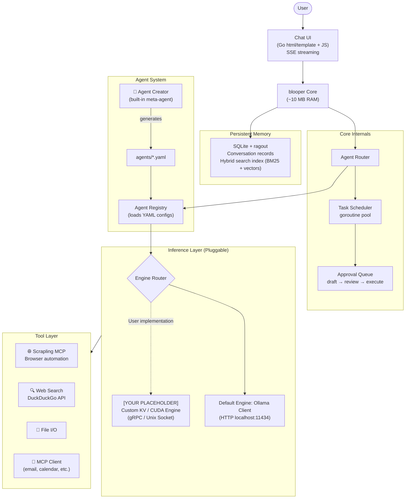

# blooper: Autonomous Productivity Agent Fleet (Go)

## Revised Vision (v3.1)

Build **blooper** — a locally-run, Go-based autonomous agent fleet for productivity tasks. A single compiled binary with minimal RAM usage (~10 MB), a chat UI (`html/template` + SSE), declarative agent configs, an Agent Creator meta-agent, and persistent searchable memory (SQLite + ragout hybrid search). Runs on local LLMs. Agents draft actions for human approval before executing.

The system is tuned to run on two target hardware profiles:
1. **Apple Silicon**: MacBook Pro M5 Pro (24 GB Unified Memory)
2. **Linux Workstation**: AMD CPU, 16 GB DDR4 System RAM, NVIDIA GeForce GTX 1080 Ti (11 GB VRAM)

> [!NOTE]
> **Learning Playground Boundary**: To preserve your hands-on learning experience, blooper's core provides a clean, working default (via Ollama API) while leaving **architectural placeholders and modular interfaces** for you to manually build your own **KV Cache Manager**, **PagedAttention engine**, or **custom vLLM/C++/CUDA inference runner**.

---

## 1. Why Go: The Case is Strong

### Memory Footprint Comparison

| Component | Python Stack | Go Stack | Savings |
| :--- | :--- | :--- | :--- |
| Runtime baseline (idle server) | ~30–50 MB (Python interpreter + FastAPI + uvicorn) | ~5–10 MB (compiled binary, net/http) | **~35 MB** |
| Per-agent goroutine/thread | ~8 MB per thread (Python threading) | ~2–8 KB per goroutine | **~1000× lighter** |
| Dependencies on disk | ~200–500 MB (pip venv, Playwright, etc.) | ~15–30 MB (single static binary) | **~10× smaller** |
| Docker image | ~300–800 MB | ~20–50 MB (from `scratch`) | **~10× smaller** |
| Startup time | ~2–5 seconds | ~50–200 ms | **~20× faster** |

### Go Ecosystem Maturity for This Project

| Capability | Go Library | Maturity |
| :--- | :--- | :--- |
| Ollama client + tool calling | Direct HTTP (no Ollama module) | ✅ In use |
| MCP (Model Context Protocol) | `github.com/modelcontextprotocol/go-sdk` (official) | ✅ Official SDK |
| Browser automation | Scrapling MCP server (`scrapling-mcp`, Python, stdio). Replaces go-rod. | ✅ In use |
| Chat UI (SSE streaming) | `net/http` + `html/template` + `static/app.js`. HTMX and Templ dropped. | ✅ In use |
| SQLite + hybrid search | `modernc.org/sqlite` (pure Go, no CGo) for storage; `github.com/chengyaolee/ragout` (BM25 + vectors, RRF) for search. Replaces FTS5. | ✅ In use |
| YAML config parsing | `gopkg.in/yaml.v3` | ✅ Standard |
| WebSocket (optional) | `github.com/gorilla/websocket` | ✅ Industry standard |

> [!TIP]
> Go eliminates the entire Python dependency chain (pip, virtualenv, Playwright npm, etc.). The final deliverable is **one binary + one SQLite file + a folder of YAML agent configs**. That's it. Copy it to any Linux box and run.

---

## 2. Hardware & Memory Analysis (Dual Target)

blooper's software layer is ultra-lightweight (~10 MB RAM), meaning almost 100% of your available memory budget is dedicated to the **LLM weights, KV cache, and browser automation**.

### Target A: Apple M5 Pro (24 GB Unified Memory)
- **Architecture**: Unified Memory Architecture (UMA) shared between CPU and GPU (~200+ GB/s bandwidth).
- **Usable Budget**: ~16–18 GB before macOS disk swapping.
- **Model Recommendation**: **Qwen3 14B (Q4_K_M)** (~10.5 GB total with KV cache). Leaves ~6 GB headroom for browser automation, tools, and OS.
- **Inference Speed**: ~20–30 tok/s.

---

### Target B: Linux Workstation (AMD CPU, 16 GB DDR4, NVIDIA GTX 1080 Ti 11 GB VRAM)

The GTX 1080 Ti is a classic, high-bandwidth card (484 GB/s GDDR5X), but its architecture requires specific considerations:

#### 1. Pascal Architecture (Compute Capability 6.1) Quirks
- **No Tensor Cores**: Pascal does not have the FP16/INT8 Tensor Cores introduced in Volta/Turing/Ampere. It executes FP32 and FP16 on standard CUDA cores (FP16 runs at 1:64 or 1:1 speed relative to FP32, rather than the 2:1 or 8:1 acceleration of modern Tensor Cores).
- **vLLM Compatibility Warning**: Official mainline vLLM has largely deprecated or dropped support for Pascal (compute capability < 7.0) because modern vLLM kernels require FlashAttention-2 and Triton features built for Turing/Ampere. Trying to run stock vLLM on a 1080 Ti often fails or requires legacy forks.
- **The Ideal Runtime**: `llama.cpp` (and Ollama which wraps it) compiles CUDA kernels that support Pascal (`sm_61`) natively and runs Q4/Q5 quantized models at peak Pascal efficiency.
- **Offloading Cliff**: In a PC with discrete GPU, the GPU has 11 GB VRAM over PCIe 3.0 x16 (~15.7 GB/s bus bandwidth). System RAM is DDR4 (~30–40 GB/s bandwidth). **If a model spills out of the 11 GB VRAM into system RAM, token generation drops from ~8–12 tok/s down to ~1–2 tok/s.** Everything active must fit in the 11 GB VRAM.

#### 2. VRAM & Model Sizing Budget (11 GB Total)

| Model Configuration | Model Weights (Q4_K_M) | KV Cache (~4K–8K ctx) | Total VRAM | Feasibility on 1080 Ti |
| :--- | :--- | :--- | :--- | :--- |
| **Qwen3 / Llama 3.1 8B** | ~4.8–5.2 GB | ~1.5–2.0 GB | **~6.5–7.2 GB** | ✅ **Sweet Spot.** Leaves ~3.8 GB VRAM headroom. |
| **Qwen2.5 / Qwen3 3B–4B** | ~2.2–2.6 GB | ~0.8–1.2 GB | **~3.2–3.8 GB** | ✅ **Ultra-fast & light.** High token speed (~25+ tok/s). |
| **Qwen3 / DeepSeek 14B** | ~8.8–9.2 GB | ~1.5–2.0 GB | **~10.5–11.2 GB** | ⚠️ **Critical Risk.** Likely triggers VRAM OOM or PCIe CPU-spillover. |
| **Llama 3.3 70B** | ~40 GB | — | **~40 GB** | ❌ Impossible in VRAM. |

#### 3. Linux Workstation System RAM Budget (16 GB DDR4 Total)

```
┌────────────────────────────────────────────────────────┐
│                   16 GB System DDR4                    │
├────────────────────────────────────────────────────────┤
│  Linux OS (Headless or lightweight X11/Wayland) ~1.5 GB│
├────────────────────────────────────────────────────────┤
│  blooper Go Binary (Compiled)                   ~10 MB │
├────────────────────────────────────────────────────────┤
│  Chromium (Scrapling browser tool)             ~400 MB │
├────────────────────────────────────────────────────────┤
│  Ollama / Inference Host Process               ~500 MB │
├────────────────────────────────────────────────────────┤
│  FREE SYSTEM RAM BUFFER                         ~13 GB │
│  (Zero memory pressure on host OS!)             ✅     │
└────────────────────────────────────────────────────────┘

┌────────────────────────────────────────────────────────┐
│                  11 GB GDDR5X VRAM                     │
├────────────────────────────────────────────────────────┤
│  Weights: 8B Model (Q4_K_M)                    ~5.0 GB │
├────────────────────────────────────────────────────────┤
│  KV Cache (4096-8192 context window)           ~2.0 GB │
├────────────────────────────────────────────────────────┤
│  CUDA Runtime Context & Scratch Buffers        ~0.8 GB │
├────────────────────────────────────────────────────────┤
│  FREE VRAM HEADROOM                            ~3.2 GB │
│  (Guarantees zero PCIe spillover to CPU RAM)   ✅     │
└────────────────────────────────────────────────────────┘
```

> [!IMPORTANT]
> **Workstation Golden Rule**: For the Linux/1080 Ti setup, default your agent configs to an **8B model (e.g., `qwen3:8b` or `llama3.1:8b`)**. It provides reliable function calling while staying comfortably under the 11 GB VRAM ceiling.

---

## 3. Manual Learning Playground: Engine & KV Placeholders

Because you want to implement low-level KV cache management and custom inference serving manually as a learning project, blooper is explicitly architected with **clean abstraction boundaries**.

blooper will ship with:
1. A **Default Ollama Engine** (so the fleet works immediately for all productivity tasks).
2. Clean **Go interfaces** with documented stub implementations for your custom engine.
3. A dedicated `experiments/custom_engine/` directory containing architecture notes, memory calculation formulas, and interface contracts.

### 3.1 The Pluggable Engine Interface

```go
// internal/llm/engine.go
package llm

import (
    "context"
    "io"
)

// InferenceEngine abstracts the LLM backend (Ollama, custom C++/CUDA server, etc.)
type InferenceEngine interface {
    // Generate sends a prompt and returns tool calls or text response
    Generate(ctx context.Context, req *ChatRequest) (*ChatResponse, error)

    // Stream streams tokens back to the UI via Server-Sent Events (SSE)
    Stream(ctx context.Context, req *ChatRequest, out chan<- StreamChunk) error

    // KVStats returns metrics from the KV cache (used for UI metrics & debugging)
    KVStats() (*KVMetrics, error)
}
```

### 3.2 The KV Cache Manager Placeholder (For You to Implement)

In typical LLM inference, the Key-Value (KV) cache grows with sequence length:
$$\text{KVCacheSize} = 2 \times \text{layers} \times \text{heads} \times \text{head\_dim} \times \text{precision\_bytes} \times \text{seq\_len}$$

For multi-agent systems, agents frequently share common system prompts or document context. A custom KV cache manager can implement:
- **Prefix Caching**: Sharing the KV cache for the system prompt across all agents.
- **Paged Attention Buffer Pool**: Managing physical memory blocks to prevent VRAM fragmentation.
- **Context Eviction / Sliding Window**: Evicting old turns when approaching context limits.

blooper provides this placeholder hook:

```go
// internal/llm/kv_placeholder.go
package llm

import "context"

// KVManager is a PLACEHOLDER interface for manual implementation.
// Implement this when you build your custom inference or paging engine!
type KVManager interface {
    // AllocateSlot reserves a KV cache context block for an agent session
    AllocateSlot(ctx context.Context, sessionID string, expectedTokens int) (slotID int, err error)

    // EvictLRU frees least-recently-used KV blocks when VRAM pressure is high
    EvictLRU(ctx context.Context) error

    // SharePrefix links a common system prompt KV block to multiple agent sessions
    SharePrefix(ctx context.Context, prefixHash string, targetSlotID int) error
}

// DefaultKVManager is a no-op stub that lets Ollama manage its own memory internally.
type DefaultKVManager struct{}

func (d *DefaultKVManager) AllocateSlot(ctx context.Context, sessionID string, expectedTokens int) (int, error) {
    // STUB: Ollama manages slots automatically.
    // Replace this with your custom implementation!
    return 0, nil
}
```

### 3.3 Learning Notes & Resources in `experiments/custom_engine/`
We will include a dedicated guide in the repository (`experiments/custom_engine/README.md`) outlining:
- Step-by-step guidance on how to write a minimal C++ / Python HTTP/gRPC server that wraps `llama.cpp` or custom CUDA kernels.
- How to compile custom CUDA kernels for Pascal (`-arch=sm_61`).
- How to measure and inspect KV cache allocations directly in VRAM.

---

## 4. Overall System Architecture



---

## 5. Component Deep Dive

### 5.1 Chat UI (Go + html/template + SSE)
- **Zero-Node / Zero-React**: Server-rendered HTML with Go `html/template`, plus a small hand-written `static/app.js`. HTMX and Templ were dropped.
- **SSE Streaming**: As the LLM generates tokens, Go flushes chunks directly to the chat bubble via `http.Flusher`.
- **Approval Cards**: Sensitive actions (e.g. sending an email, submitting a web form) render an interactive card with `[Approve]`, `[Edit]`, `[Reject]` buttons.

### 5.2 Declarative Agent System (`agents/*.yaml`)
Agents are defined in simple YAML files. The registry loads them dynamically:
- `name` and `display_name`
- `persona` (role, instructions, system prompt)
- `model` (preferred model name, fallback, temperature)
- `tools` (whitelisted tools)
- `delegation` (which peer agents this agent is allowed to invoke)
- `approval` (list of actions requiring human sign-off)

### 5.3 Agent Creator Meta-Agent (*Priority 1*)
A built-in agent that acts as your systems architect. You talk to it in the Chat UI, describe what you want an agent to do, and it:
1. Asks clarifying questions (tools needed, tone, approval requirements).
2. Generates a clean, validated `agents/<name>.yaml` file.
3. Automatically registers the new agent in the running fleet without restarting the server.

### 5.4 Persistent Memory (SQLite + ragout)
- Conversations are saved to an on-disk SQLite database, which remains the record store.
- ragout indexes them and owns search, with snapshots stored next to the database (`<db>.vec`, `<db>.bm25`). Existing conversations are indexed on first open.
- Agents have access to a `recall("query")` tool that performs hybrid search over past conversations: BM25 plus local vector embeddings (Ollama `nomic-embed-text`), fused with RRF. Replaces the original FTS5 plan.
- Hierarchical memory (not in the original plan): an orchestrator (`internal/memory/context.go`) builds layered prompts, stores large tool output as artifacts, and compacts old steps. Persistent user rules (`internal/memory/rules.go`, `MEMORY.md`) are saved only from user-typed text.
- Zero RAM overhead when not actively querying.

### 5.5 Tool Layer & Delegation
- **Browser Automation (Scrapling MCP)**: Chrome driven through Scrapling's MCP server over stdio, with stealth fingerprints and one session kept open across calls. Supports navigate, extract text, click, fill, and screenshot. Replaces go-rod. On headless Linux without a display, it runs on Xvfb when available.
- **Web Search**: DuckDuckGo API for quick fact-finding without full browser overhead.
- **MCP Client**: Standardized interface for email and calendar integrations using the official Go MCP SDK.
- **Delegation Protocol**: Agents can invoke other specialized agents as sub-routines via Goroutines.

---

## 6. Project Structure

```
blooper/
├── go.mod
├── go.sum
├── main.go                          # Entry point, starts HTTP server
├── cmd/
│   └── blooper/
│       └── main.go                  # CLI flags, config loading
│
├── internal/
│   ├── agent/
│   │   ├── agent.go                 # Agent struct, Run() loop
│   │   ├── registry.go              # Loads YAML configs, manages agent catalog
│   │   ├── config.go                # AgentConfig struct (parsed from YAML)
│   │   ├── creator.go               # Agent Creator meta-agent logic
│   │   └── watcher.go               # fsnotify watcher for hot-reloading agent YAMLs
│   │
│   ├── core/
│   │   ├── router.go                # Routes user messages to agents
│   │   ├── scheduler.go             # Task scheduling, goroutine pool
│   │   ├── approval.go              # Approval queue (draft → approve → execute)
│   │   └── delegation.go            # Agent-to-agent delegation protocol
│   │
│   ├── llm/
│   │   ├── engine.go                # InferenceEngine interface
│   │   ├── ollama.go                # Default Ollama HTTP client implementation
│   │   ├── kv_placeholder.go        # [PLACEHOLDER] KV Cache manager interface & stubs
│   │   ├── kv_allocator.go          # KVSlot + SlotManager: slot allocation, eviction, stats
│   │   ├── models.go                # Model registry & hardware-tuned defaults
│   │   └── streaming.go             # SSE token streaming to UI
│   │
│   ├── memory/
│   │   ├── store.go                 # SQLite connection, schema migration
│   │   ├── summarizer.go            # LLM-based conversation summarization
│   │   ├── context.go               # Orchestrator: layered prompts, artifacts, compaction
│   │   ├── rules.go                 # Persistent user rules (MEMORY.md)
│   │   └── recall.go                # Hybrid search over past conversations (ragout)
│   │
│   ├── tools/
│   │   ├── tool.go                  # Tool interface definition
│   │   ├── registry.go              # Tool registry
│   │   ├── browser.go               # Browser tool, Scrapling MCP over stdio (replaces Rod)
│   │   ├── search.go                # DuckDuckGo web search
│   │   ├── files.go                 # File read/write
│   │   ├── delegate.go              # Delegation tool
│   │   ├── recall.go                # Memory recall tool
│   │   └── mcp.go                   # Generic MCP client (Phase 3)
│   │
│   └── ui/
│       ├── server.go                # HTTP handlers, SSE endpoints
│       ├── routes.go                # Route definitions
│       └── templates/
│           └── index.html           # Single page: chat, agents, approvals (html/template)
│
├── experiments/                     # [LEARNING PLAYGROUND]
│   └── custom_engine/
│       ├── README.md                # Notes on custom KV cache, Pascal CUDA, and vLLM
│       └── stub_client.go           # Example code connecting to a custom engine
│
├── agents/                          # Built-in agent configs
│   ├── agent_creator.yaml           # Priority 1 meta-agent
│   ├── web_researcher.yaml
│   └── email_drafter.yaml
│
├── user_agents/                     # User-created agents (gitignored)
│   └── .gitkeep
│
├── config/
│   ├── blooper.yaml                 # Global config (Ollama URL, default model, etc.)
│   └── hardware.yaml                # Hardware profile presets (m5_pro vs linux_1080ti)
│
├── data/                            # Runtime data (gitignored)
│   └── blooper.db                   # SQLite database (conversations, memory)
│
├── static/                          # Static assets
│   ├── app.js                       # Chat, approvals, and SSE client (no HTMX)
│   └── style.css
│
└── Makefile                         # Build, run, test, and cross-compile targets
```

---

## 7. Phased Roadmap

### Phase 1: Agent Creator + Chat UI Skeleton + Engine Stubs (Weeks 1–2)
- [x] Go project scaffolding (`go.mod`, directory structure)
- [x] Pluggable `InferenceEngine` interface + default Ollama client (direct HTTP)
- [x] KV cache manager placeholder stubs (`internal/llm/kv_placeholder.go`) + `SlotManager` (`kv_allocator.go`)
- [x] Agent config schema and YAML parser (`internal/agent/config.go`)
- [x] Agent registry that loads from `agents/` directory (`internal/agent/registry.go`)
- [x] Agent Creator with `create_agent_config` tool (`internal/agent/creator.go`)
- [x] Chat UI with SSE streaming (`internal/ui/` via `html/template` + `static/app.js`; Templ and HTMX dropped)
- [x] Approval card component: approve/reject. The Edit button is not built.
- [ ] Settings page with model & hardware profile switcher (M5 Pro vs Linux 1080 Ti presets). `config/hardware.yaml` exists, but nothing switches models from it yet.
- [x] Entry point (`cmd/blooper/main.go`)

### Phase 2: Core Loop + Browser + Memory (Weeks 3–5)
- [x] Browser tool via Scrapling MCP (`internal/tools/browser.go`). Replaces the Rod integration. DOM simplification was not verified.
- [x] DuckDuckGo search tool (`internal/tools/search.go`)
- [x] Agent-to-agent delegation (`internal/core/delegation.go`)
- [x] Persistent memory (`internal/memory/`) with `recall` tool. Hybrid search via ragout replaces SQLite FTS5.
- [x] Task scheduler with goroutine pool

### Phase 3: MCP Integration + Email/Calendar (Weeks 6–8)
- [ ] MCP client implementation using official Go SDK (`internal/tools/mcp.go`). The go-sdk is a dependency, but only the browser tool uses MCP so far, and there is no generic client.
- [ ] Email MCP server (IMAP/SMTP)
- [ ] Calendar MCP server
- [x] Hot-reload for agent YAMLs (`internal/agent/watcher.go`)

### Phase 4: Polish + Linux Cross-Compilation & Experiments (Weeks 9–10)
- [x] `Makefile` targets for native build and Linux cross-compilation (`GOOS=linux GOARCH=amd64`). Both build now that the entry point exists.
- [ ] Systemd service file for Linux workstation deployment
- [ ] `experiments/custom_engine/` documentation and integration tests for your custom engine experiments

### Phase 5: Phone remote control (see `docs/REMOTE.md`)
- [x] Entry point with subcommands (`cmd/blooper/main.go`: `serve`, `runner`, `pair`, `devices`, `revoke`)
- [x] Coordinator: signed device requests, QR enrollment, durable jobs, leases, approvals (`internal/remote/`)
- [x] Desktop runner with `repo_run_tests`, `app_open`, `web_search` (`internal/runner/`)
- [x] OpenAI engine for the planner (`internal/llm/openai.go`); Ollama fallback
- [x] Deepgram transcription through the coordinator; on-device speech on the phone
- [x] iOS app source (`ios/BlooperRemote/`). Not yet compiled or run on a device.
- [ ] Push notifications (APNs)
- [ ] Hands-free entry (Siri / App Shortcut)
- [ ] Cloud workspace provisioning; direct Tailscale path
- [ ] Lock-screen and GUI-readiness checks; reconciliation flow

---

## 8. Key Dependencies

```go
module github.com/chengyaolee/blooper

go 1.23

require (
    // LLM & API
    // Ollama: direct HTTP client, no module

    // UI & Web: net/http + html/template (no Templ)

    // Browser: Scrapling MCP server, a Python subprocess (no Go module)

    // MCP
    github.com/modelcontextprotocol/go-sdk   v1.8.0  // Official MCP Go SDK

    // Search
    github.com/chengyaolee/ragout            v0.0.0-20261020102032-e0fe1ac0d3b9  // BM25 + vector hybrid search

    // Storage (Pure Go SQLite, zero CGo)
    modernc.org/sqlite                     v1.59.0

    // Config & Utilities
    gopkg.in/yaml.v3                       v3.x.x
    github.com/fsnotify/fsnotify           v1.x.x
)
```

> [!IMPORTANT]
> **Zero CGo**: All core dependencies are pure Go. This guarantees that running `GOOS=linux GOARCH=amd64 go build` on your Mac produces a clean static binary ready to deploy straight to your Linux AMD workstation without toolchain friction.
