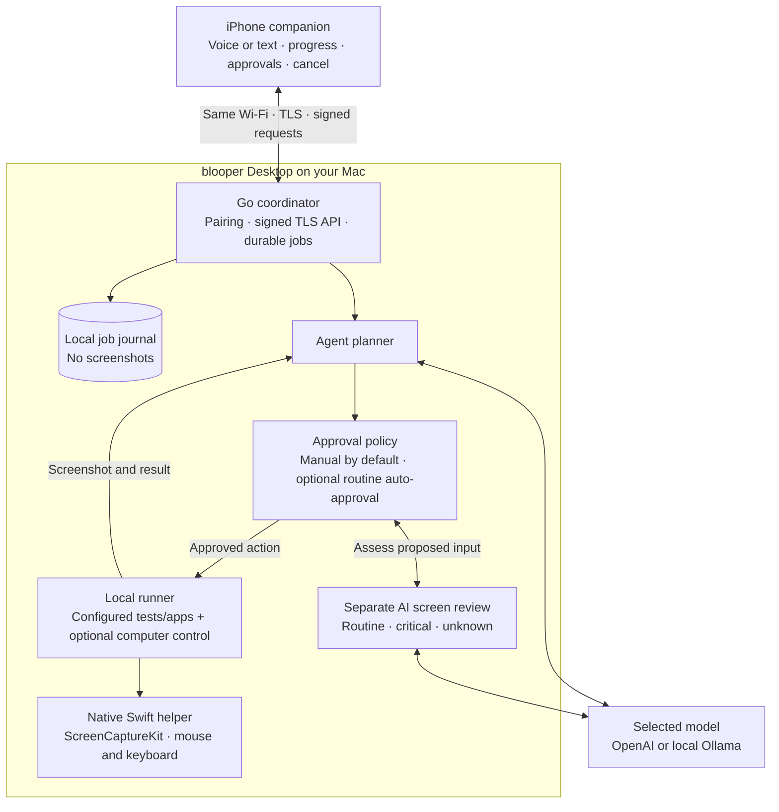

# blooper

Send a spoken or typed instruction from your iPhone and let your computer carry it out.
blooper combines an agent fleet, a desktop runner, and optional **Mac computer control**:
see the screen, click, type, use keyboard shortcuts, and scroll. Follow the job from your
phone, approve consequential steps, or enable **auto-approval for routine steps**.

**Installers are not published yet.** Run from a clone using the setup script below.
Computer control targets **macOS 14+** first; the iPhone companion targets **iOS 17+** and
must be built in Xcode. Both devices must be on the **same Wi-Fi**. Windows supports the
desktop shell and configured runner actions; native Windows computer control is not built.

## Architecture



The Electron app manages settings, credentials, pairing, and the bundled Go runtime. The
coordinator records each phone request as a job; the planner proposes typed actions; the
approval policy decides whether to ask you; and the runner executes on the selected computer.
The Mac helper captures a fresh screen after input so the planner can check the result. The
phone shows the latest captured screen and job timeline. Jobs continue if the phone closes,
provided the computer stays awake and blooper keeps running.

Provider keys are encrypted locally with macOS Keychain or Windows DPAPI and passed to the
runtime in memory. Keys never go to the phone. OpenAI receives prompts, screenshots, and
results needed for inference; Ollama keeps inference local. Screenshots stay in memory,
outside the saved job journal, artifacts, and summaries. Action arguments, typed text, and
results remain in job history. The computer-control loop uses the existing model's vision
and function tools with native Mac input; it does not use the OpenAI Responses computer-use tool.

The desktop automatically enrolls its local runner. No separate server, runner command,
Tailscale, account, hosted relay, port forwarding, or APNs key is needed for this setup.

## Set up from source on a Mac

### 1. Install prerequisites

- **Git**, **Go 1.27.1+** (see `go.mod`), **Node.js 22+**, and npm.
- **Xcode Command Line Tools** for the Swift computer helper. If missing, run
  `xcode-select --install` and finish installation before continuing.
- **Full Xcode**, including the iOS SDK, and **XcodeGen** to build the iPhone app.
  Install Xcode from the App Store and open it once to complete setup and accept its license.
  Command Line Tools alone cannot build the phone app.
- A signing team/profile supporting the iPhone project's Push Notifications entitlement.
  See [iPhone signing and APNs details](docs/REMOTE.md#push-notifications).

If you use [Homebrew](https://brew.sh), install the language tools and XcodeGen with:

```sh
brew install go node xcodegen
```

Go and Node can also be installed from [go.dev](https://go.dev/dl/) and
[nodejs.org](https://nodejs.org/). The setup script checks prerequisites and reports missing
tools; it does not install Homebrew, change your system toolchain selection, or grant permissions.

### 2. Build and launch blooper

```sh
git clone https://github.com/chengyaolee/blooper.git
cd blooper
./scripts/setup-desktop.sh --ios --launch
```

The script installs desktop dependencies with `npm ci`, builds the bundled Go runtime and
Swift helper, runs the helper's check without capturing the screen or sending input, generates
the iPhone Xcode project, and launches the desktop app. It leaves `.env`, CLI configuration,
provider settings, and OS permissions untouched. It detects full Xcode at its standard path;
for a custom Xcode installation, set `DEVELOPER_DIR` when invoking the script.

Omit `--ios` for desktop-only setup, or omit `--launch` to build without opening the app.
Check prerequisites without installing dependencies, building, or generating files:

```sh
./scripts/setup-desktop.sh --check --ios
```

To launch again from the repository root:

```sh
cd desktop
npm start
```

Keep the launching terminal open. Closing the app window leaves blooper in the menu bar;
choose **Quit blooper** before closing its terminal. Launch-at-login and automatic-update
installation are features of installed builds, not this source setup.

### 3. Connect a model and choose permissions

1. Open **Settings → Model provider**, select **OpenAI**, enter an API key from the
   [OpenAI platform](https://platform.openai.com/api-keys), and choose **Validate and save**.
   The default model is `gpt-5.4-mini`; Ollama is not required.
2. Optionally connect [Deepgram](https://console.deepgram.com/) for hosted voice transcription.
   Otherwise the phone can use on-device transcription.
3. Open **Permissions**. Add any workspace folders and test commands you want to allow, and
   applications you want to launch by name. Save permissions. These are optional for screen
   tasks, which have a separate, broad computer-control permission.
4. Under **Computer control**, choose **Set up Mac permissions…**. In macOS **Privacy &
   Security**, grant **Accessibility** and **Screen & System Audio Recording** access. In a
   development launch, macOS may list **blooper-computer** or the development app separately.
5. Quit and reopen blooper. Enable **Allow my paired phone to control this Mac** and choose
   **Save permissions**. Computer control is off by default.
6. Optionally enable **Auto-approve routine steps** and save. See the policy below.

Credentials can be validated, replaced, or deleted in Settings. Saved key values are not
returned to the renderer or phone. The desktop does not import `.env`. Validation and hosted
inference can use provider credit.

For local inference, install and start [Ollama](https://ollama.com/), pull a model, and select
it in Settings. Screen tasks need a model that supports **both images and tools**. The local
text-only `qwen2.5:3b` works for ordinary agent tasks but cannot read screenshots. Conversation
recall uses local text search and needs no embedding model.

### 4. Build the iPhone companion

The `--ios` setup option generates `ios/BlooperRemote/BlooperRemote.xcodeproj`. Set your signing
team and a unique bundle identifier in the existing `settings.base` block of
[ios/BlooperRemote/project.yml](ios/BlooperRemote/project.yml), using the keys
`DEVELOPMENT_TEAM` and `PRODUCT_BUNDLE_IDENTIFIER`. In a new terminal at the repository root,
regenerate and open it:

```sh
cd ios/BlooperRemote
xcodegen generate
open BlooperRemote.xcodeproj
```

Select your connected iPhone in Xcode and build/run the **BlooperRemote** scheme. Allow camera
access for pairing, local-network access for connecting, and microphone/speech access when
using voice. Push delivery is optional and requires separate APNs setup; local jobs and their
in-app event feed work without an APNs service. App Store/TestFlight distribution is not
provided by the setup script.

### 5. Pair and send your first instruction

1. Keep the iPhone and Mac on the **same Wi-Fi**, with the Mac awake, unlocked, and running blooper.
2. On the desktop, open **Devices**, select the Wi-Fi interface if needed, and choose
   **Create pairing code**. Keep the QR code visible.
3. On the phone, choose **Scan pairing code** and scan it. The code pins the computer's TLS
   identity; subsequent requests are encrypted and signed.
4. Select the Mac and send a request such as **“Open Notes and write a note that says buy milk.”**
   Review the latest screen and any approval prompts in the job view. Tap **Cancel** to stop.
   Avoid operating the Mac's mouse and keyboard while a job is running.

Use **Computers → Pair another computer** to add another host. Each host keeps its own keys,
permissions, and jobs. Bonjour/mDNS helps paired phones rediscover changed local addresses.
If pairing fails, check local-network permission, the desktop firewall, and Wi-Fi client
isolation; guest networks may block device-to-device connections. A backgrounded phone can
appear offline because its heartbeat stops. See [connectivity details](docs/DESKTOP.md).

## Routine auto-approval

Enable **Permissions → Computer control → Auto-approve routine steps** on the Mac, then save.
It is off by default, applies to that computer, and can only be changed when no jobs are active.

| Step | With routine auto-approval enabled |
| --- | --- |
| Screenshots | Continue under the runner's standing grant, as in manual mode |
| Launch an allowed app; scroll the current view | Continue automatically |
| Navigate, focus a field, select text, or draft ordinary text | Continue only after a separate AI review identifies the step as routine |
| Sending/publishing, submitting forms, purchases, deletion/overwrite, account/security changes, or uncertain effects | The review must request phone confirmation |
| Enter, delete/save shortcuts, or text containing control characters | Always request phone confirmation |
| Missing, malformed, timed-out, or failed AI review | Request phone confirmation |

The reviewer sees the current screenshot, your request, and the exact proposed action in a
separate model call with no execution tools. The planner cannot supply its own risk label.
Reviews add inference latency/cost and can misjudge a step; this is not OS application isolation.
Auto-approved steps and review reasons are recorded in the timeline. Expired runner grants
still require approval, and web-search confirmation remains separate.

Rejecting an action prevents it from running. Cancellation stops subsequent actions and asks
the runner to stop active work; it cannot undo input already delivered. A lost runner with an
action in flight is marked for reconciliation and is not blindly retried.

## Current limits

Mac computer control covers one **main display**, including Retina coordinate scaling, and
checks for an unlocked desktop before input. It cannot wake/unlock the computer, control a
secondary display, or provide direct manual phone gestures. Cross-network access, native
Windows computer control, published installers, App Store distribution, and production update
releases remain separate work. Real Mac input, OS permission dialogs, and physical-device
pairing still need device validation; automated checks cover the software flow.

## Windows source setup and local installer builds

The macOS setup script does not run on Windows. For the desktop shell and configured runner
actions, install Go and Node.js as above, then run from `desktop/` in PowerShell:

```powershell
npm ci
npm start
```

Developers can create local development installers on the target platform with `npm run dist`
from `desktop/`. Output goes to `desktop/dist/` (macOS DMG/ZIP or Windows NSIS installer).
For an unpacked macOS development bundle, run `CSC_IDENTITY_AUTO_DISCOVERY=false npm run pack`.
These builds are not published production releases. See [build and signing details](docs/DESKTOP.md#build-and-release).

## Advanced: command-line and self-hosted setup

The CLI remains available for separate coordinators and runners. From the repository root,
set the provider key in the shell that starts blooper:

```sh
# macOS/Linux shell
export OPENAI_API_KEY="your-key"
export DEEPGRAM_API_KEY="your-key"  # optional

go run ./cmd/blooper serve -config config/blooper.yaml
```

In PowerShell:

```powershell
$env:OPENAI_API_KEY = "your-key"
$env:DEEPGRAM_API_KEY = "your-key"  # optional

go run ./cmd/blooper serve -config config/blooper.yaml
```

With the default `remote.planner: auto`, an OpenAI key selects hosted inference for chat,
delegation, and remote planning. To run locally, select `remote.planner: ollama` and install the
models configured in `agents/` and `config/blooper.yaml`.

The direct `go run` command does not load `.env`. The existing macOS/Linux setup script
(`./scripts/setup.sh`, or `make setup`) creates a local configuration; `make serve` loads `.env`
and starts that configuration. Never commit `.env`, API keys, APNs keys, or runner identities.

For separately enrolled computers, copy `config/runner.example.yaml` to `runner.yaml`, configure
its coordinator URL and permitted actions, then run:

```sh
go run ./cmd/blooper runner -config runner.yaml
```

Use HTTPS for network connections. The desktop app handles local certificates and pairing
itself; advanced self-hosted installations manage their own transport. The iPhone's Advanced
connection section supports manual server addresses with publicly trusted TLS certificates.
See [remote coordinator, runner, TLS, and APNs instructions](docs/REMOTE.md).

Push delivery through a blooper-operated notification service is outside this local-first phase.
The advanced self-hosted server supports owner-configured APNs. Customers do not need an APNs
signing key for local desktop operation, and public desktop installers must never contain one.

## Optional browser tool

Basic chat, delegation, web search, drafting, and runner actions do not require this integration.
The `browser` tool uses [Scrapling](https://github.com/D4Vinci/Scrapling)'s MCP server. To enable
it on macOS/Linux, install Python 3.10 or newer and run:

```sh
python3 -m venv ~/.venvs/scrapling
~/.venvs/scrapling/bin/pip install "scrapling[ai]"
~/.venvs/scrapling/bin/scrapling install
export SCRAPLING_MCP_BIN=~/.venvs/scrapling/bin/scrapling-mcp
```

Launch blooper with that environment, or put `scrapling-mcp` on its PATH. For GUI launches,
ensure the desktop process can find the integration. Headless Linux installations may also
need Xvfb. A missing browser integration returns an installation hint.

## Agent permissions and approvals

An agent's YAML `tools` list is its allowlist: unlisted shared tools are neither exposed nor
executable. Empty means no shared tools. Memory helpers (`read_artifact`, `remember_rule`)
remain managed by the agent's memory orchestrator. Unknown tool names fail validation.

`require_approval_for` must name tools in the same allowlist. An intrinsic tool approval
requirement always applies. The agent pauses until approval or rejection; disconnecting the
chat cancels pending approval, and a decision cannot be reused.

Delegation requires `delegate` in `tools` plus permitted targets in `can_delegate_to`. Target
restrictions and depth limits apply, including approvals inside delegated agents. Chat agent
delegation and the phone's runner-job tools remain separate execution paths.

## Verification

From the repository root:

```sh
go test -race ./...
go build ./...
go vet ./...
python3 scripts/test-setup-desktop.py
```

Desktop credential-storage checks:

```sh
cd desktop
npm ci
npm test
```

On macOS, after building the desktop runtime, the shell and TLS-pinning checks run from the
repository root with isolated temporary profiles:

```sh
./desktop/node_modules/.bin/electron desktop/test/smoke.cjs
python3 scripts/test-local-trust.py
```

[Desktop verification instructions](docs/DESKTOP.md#checks) include opt-in live OpenAI and Ollama
delegation checks. [Hosted provider checks](docs/REMOTE.md#hosted-service-keys-and-checks) cover
OpenAI and Deepgram. These live checks require keys and can incur provider charges. Signed iOS
builds, physical-device pairing, Windows installation, and production update cycles still need
platform validation.
