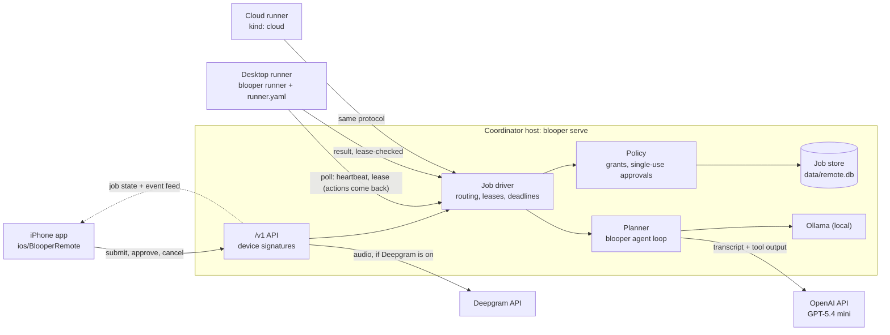

# blooper Remote: the phone as a remote control

For the installable, same-Wi-Fi desktop and iPhone setup, start with [Desktop apps](DESKTOP.md).
The manual server and runner setup below remains available for advanced/self-hosted installations.

Speak or type a request on an iPhone. The coordinator inside `blooper serve` records it as a durable job, plans it with a model, and hands typed actions to a runner on the computer that does the work. The phone can close; the job continues, and the app catches up when it reopens.

This implements the first build of `Voice_Agent_Protocol_Brief.md`, adapted to blooper.

## Architecture



Arrows start at the side that opens the connection. Phones and runners only make outbound requests.

| Brief component | In blooper |
| --- | --- |
| Phone app | `ios/BlooperRemote` (SwiftUI) |
| Coordinator and job store | `internal/remote`, mounted at `/v1` by `blooper serve`, state in `data/remote.db` |
| Agent planner | The existing agent loop (`internal/agent`) and memory orchestrator, given remote tools |
| Planner model | `internal/llm/openai.go` on the existing `InferenceEngine` interface; Ollama when no key is set |
| Desktop runner | `internal/runner`, started with `blooper runner` |
| Cloud worker | The same runner with `kind: cloud` |

### How the brief was changed to fit

- **Tool names use underscores** (`repo_run_tests`, `app_open`, `web_search`). OpenAI-compatible APIs reject dots in function names.
- **The planner always runs on the coordinator.** It reuses blooper's agent loop. Each tool call blocks until the runner reports, so the loop needs no changes.
- **Approvals are new, not blooper's chat approval queue.** The chat queue is in memory and pauses its original agent call until approved or rejected; closing the chat cancels pending approvals. Remote approvals live in the job journal, pause the job, and are consumed by a single-use challenge tied to the exact action.
- **Routing is rule-based.** The target comes from the request, a device name in the transcript, or the word "cloud". If more than one computer could take the job, the phone is asked.
- **Runners never receive commands.** The planner names a workspace or app. The command comes from `runner.yaml` on that computer.
- **Device identity is an Ed25519 key.** Every request is signed over method, URI, timestamp, and body hash. There is no account system; the first phone pairs with a code printed by the server.

## Setup

For the recommended bundled macOS desktop setup, run `./scripts/setup-desktop.sh --ios --launch`
and follow the [README walkthrough](../README.md#set-up-from-source-on-a-mac).

For the advanced CLI setup below, run `scripts/setup.sh`. It checks tools, builds, detects Tailscale for HTTPS (or falls back to LAN), writes the config, offers to set up this computer as a runner, and prints the next commands. Add `--runner` to skip the runner question, or `--lan` to skip Tailscale. The steps below are what it does.

Then `make serve`, and `make runner` on each computer.

Manual steps, if you prefer:

1. **Server.** Set keys if you want the hosted services, then start it.

   ```sh
   export OPENAI_API_KEY=...   # optional: planner uses OpenAI GPT-5.4 mini; otherwise local Ollama
   export DEEPGRAM_API_KEY=...   # optional: offers Deepgram transcription; otherwise on-device only
   make run                      # or: go run ./cmd/blooper
   ```

   Set `remote.public_url` in `config/blooper.yaml` to the address phones and runners can reach. With no phone enrolled, the server prints a pairing QR. `blooper pair` prints a new one later.

2. **Phone.** Build the app (`cd ios/BlooperRemote && xcodegen generate && open BlooperRemote.xcodeproj`), then scan the pairing QR.

3. **Each computer.** Copy `config/runner.example.yaml` to `runner.yaml`, list its workspaces and apps, and run `blooper runner -config runner.yaml`. It shows a QR. In the app, open Devices, tap Add computer, scan it, review what it asks for, and enroll.

4. **Use it.** "Run the tests in the blooper workspace on my Mac Studio."

Other commands: `blooper devices` lists devices, `blooper revoke <id>` cuts one off (use this for a lost phone).

### Transport

Requests are signed, so they cannot be forged or altered, but plain HTTP is not private. Use one of:

- `server.tls_cert` and `server.tls_key` in `config/blooper.yaml` (for example from `tailscale cert`).
- A reverse proxy or `tailscale serve`. Forward only `/v1/`: the chat UI has no authentication and is limited to loopback connections, which a proxy on the same host would satisfy.

The iOS app allows plain HTTP only to local-network addresses.

## Behaviour

**Job states:** `accepted`, `waiting_for_clarification`, `waiting_for_target`, `queued`, `running`, `waiting_for_approval`, `cancel_requested`, then one of `succeeded`, `failed`, `cancelled`, `expired`, `needs_reconciliation`.

- **Idempotent submit.** The same phone and `client_request_id` return the same job. Reusing the ID with a different request is refused.
- **"Running" means claimed.** A job is `queued` until its runner polls and takes the lease. If the runner is asleep or offline the job waits in `waiting_for_target` and says why.
- **Standing grant.** Enrolling a computer grants its routine tools for 90 days. `app_open` asks first unless routine auto-approval is enabled. Every tool asks once the grant has expired.
- **Computer control.** An explicitly enabled Mac runner can observe the main display and propose mouse/keyboard input. Inputs need single-use phone approval by default; the optional routine auto-approval policy is described below. Screenshots run under the standing grant.
- **Leases.** A runner renews its lease by polling. If it goes silent for 90 seconds with an action in flight, the job becomes `needs_reconciliation` and is not retried, because the action may or may not have happened. A runner that returns late has its result refused.
- **Cancel.** Recorded at once as `cancel_requested`. The job becomes `cancelled` only when the runner reports that the process has stopped. Completed actions stay in the journal.
- **Deadline.** One hour by default (`remote.job_timeout`), enforced whether or not the phone is connected.
- **Restart.** Jobs that had not acted yet start over. Jobs that had acted end as `failed` or `needs_reconciliation`, because the planner's context is not kept across a restart.
- **A job that ran nothing is `failed`**, even if the model replies politely.

## Mac computer control

The optional `computer` runner tool uses a bundled Swift helper and native macOS
ScreenCaptureKit/CoreGraphics APIs on macOS 14 or newer. It supports `screenshot`, `click`,
`double_click`, `right_click`, `type`, `key`, and `scroll`. It uses the existing vision-capable
planner's function tools, rather than OpenAI's built-in Responses API computer-use tool.
No Python installation, browser driver, or additional provider credential is needed.

Enable it on the desktop Permissions page after requesting macOS Accessibility and Screen
Recording access. Permission prompts can only be requested from the authenticated local
desktop UI. The phone/planner cannot enable control or grant OS permissions. For a separate
CLI runner, set `computer: true` in its local YAML and put the built `blooper-computer` helper
beside the runner executable. In development, macOS may list that helper separately in Privacy
& Security. Reopen blooper after changing OS permissions.

The runner first requires a screenshot for the job and checks for an unlocked console session
and screen permission before acting. Coordinates refer to the screenshot, resized to at most
1600 pixels on its longest edge, including on Retina displays. Click bounds, literal text,
named keys, scroll directions, and sizes are validated at both coordinator and runner. The
helper receives JSON through stdin, without a shell or provider credentials. After each input,
it captures a new screen for the planner to inspect. Do not operate the Mac while a job runs.

Screenshots are binary image inputs, kept separate from text tool output, artifacts, summaries,
and the persisted job journal. Only the latest screenshot stays in the model's working context.
The phone shows the job's most recent captured screen; this is a snapshot, not a live feed.
That preview remains in coordinator memory until restart. With OpenAI, screenshots leave the
Mac for inference. With Ollama, select a model supporting both images and tools; the default
text-only `qwen2.5:3b` cannot perform screen tasks. The action journal still stores typed text
and action arguments; do not use it to enter passwords or secrets.

Each input requires approval by default. **Auto-approve routine steps** on the desktop
Permissions page (CLI: `auto_approve_routine: true`, requiring `computer: true`) opts into
automatic allowed-app launches and scrolling while the 90-day grant is valid. Other input
is reviewed separately using the current screenshot, original request, and exact proposed
action. The review has no tools and runs outside the coordinator lock; the planner cannot
supply its own risk classification. Only a valid `routine` review bypasses confirmation.
Critical, unknown, missing, malformed, timed-out, and failed reviews ask for approval. Review
requests use the selected provider and can add inference latency and cost. AI classification
is best effort and can misjudge a target; it is not an OS security boundary.

The review policy treats sending, publishing, submitting forms, purchasing, deleting,
overwriting files, account/security changes, secrets, and executable commands as critical.
Commit/editing keys outside a small navigation allowlist (including Enter, Backspace/Delete,
and Cmd+S) and text containing control characters always ask, independently of the AI review.
The setting is stored locally, advertised at enrollment, and cannot be enabled by the planner
or changed during an active job. Auto-approved actions and review reasons remain in the job
timeline. Web-search approvals and expired-grant checks still apply.

A rejected action is not retried;
cancelling stops subsequent actions but cannot undo input already delivered. Lease loss keeps
the existing reconciliation behavior. Two computer-control jobs cannot share the same display
at once. This is broad desktop access, separate from the app-launch allowlist; planner rules
prohibit using terminals or scripts to bypass the typed tools, but this is not OS app isolation.
Windows control, secondary displays, direct manual phone gestures, waking/unlocking the Mac,
and connectivity outside the LAN are not implemented.

To check a desktop build without capturing the screen or delivering input:

```sh
cd desktop
npm run build:runtime
./bin/blooper-computer --self-test
```

For a physical-device check, enable the permissions, pair the phone, and request a harmless
note in a test application. Review the initial screenshot, reject an input and verify it did
not run, then try a new job and approve its inputs. Verify Unicode typing, Retina click
positions, scrolling, cancellation, a locked Mac, and denied OS permissions. Automated Go
checks cover argument validation, image formats, approval challenges, lease fencing, and
the absence of screenshots in saved jobs; actual OS input and permission dialogs require
this device check.

**API**

| Endpoint | Caller | Purpose |
| --- | --- | --- |
| `POST /v1/pair` | new phone | Enroll with the server's pairing code |
| `POST /v1/enroll` | new runner | Get an enrollment code to show as a QR |
| `GET /v1/enroll/{code}`, `POST .../approve` | phone | Review and enroll a runner |
| `GET /v1/devices`, `DELETE /v1/devices/{id}` | phone | List, revoke |
| `POST /v1/push-token`, `DELETE /v1/push-token` | phone | Register or remove this phone's APNs token |
| `POST /v1/transcribe` | phone | Audio to text through Deepgram |
| `POST /v1/jobs`, `GET /v1/jobs` | phone | Submit, list |
| `GET /v1/jobs/{id}?after=N` | phone | Job and event feed; holds until an event past `N` |
| `POST /v1/jobs/{id}/clarify`, `/approval`, `/cancel` | phone | Answer, approve or reject, stop |
| `POST /v1/runner/poll`, `/v1/runner/result` | runner | Heartbeat and work; report an outcome |

## Where data goes

| Data | Stays on | Leaves when |
| --- | --- | --- |
| Audio | The phone; deleted after transcription | Deepgram is switched on in the app: phone, coordinator (memory only), Deepgram |
| Transcript, tool output | The coordinator's job store | OpenAI is the planner. With Ollama it stays local. |
| Commands, file paths | `runner.yaml` on each computer | Never |
| Private keys | iOS Keychain, `runner.key` | Never |

## Push notifications

Push is optional. Without APNs credentials, the app continues to use its event feed.
Alerts are sent to the phone that submitted a job when it finishes (including failure,
cancellation, expiry, or reconciliation), needs approval, or asks which computer to use.
Tapping an alert opens that job. Approvals still require reviewing the action inside the app.

1. Join the [Apple Developer Program](https://developer.apple.com/programs/).
   In [Certificates, Identifiers & Profiles](https://developer.apple.com/account/resources/identifiers/list),
   create an explicit App ID for `com.blooper.remote` (or your own bundle ID) and enable **Push Notifications**.
2. Under **Keys**, create an **Apple Push Notifications service (APNs)** authentication key.
   Download the `.p8` file once; keep it outside this repository. Note its Key ID and your
   Team ID from Apple Developer membership details. A key restricted to a topic or environment
   must permit this app and the environment below.
3. Set these variables in the environment that starts blooper:

   ```sh
   export APNS_KEY_PATH="$HOME/.config/blooper/AuthKey_YOURKEYID.p8"
   export APNS_KEY_ID="YOURKEYID"
   export APNS_TEAM_ID="YOURTEAMID"
   ```

   Set these values in the config you actually start with (`config/blooper.local.yaml` if using `make serve`):

   ```yaml
   push:
     topic: "com.blooper.remote"
     environment: "sandbox"
   ```

   Use `sandbox` for Xcode development builds, and `production` for TestFlight or App Store builds.
   The server uses one environment at a time. The topic must exactly match `PRODUCT_BUNDLE_IDENTIFIER`.
   All three credential variables are required together. No APNs credentials means push is disabled.
4. Regenerate the iOS project with `xcodegen generate`, select your development team in Xcode,
   and ensure the signing profile includes Push Notifications. `project.yml` supplies the
   `aps-environment` entitlement for Debug (`development`) and Release (`production`). If you choose
   your own bundle ID, change it in both `project.yml` and `push.topic`.
5. Pair the app and tap **Enable notifications**. Allow the iOS permission prompt.
   The app registers its APNs token using its signed device identity, refreshes registration on launch,
   and retries synchronization when foregrounded. **Disable notifications** removes the token from
   the server. Unpairing removes it before forgetting the server; revocation also removes it.
6. On a signed device build, background the app, finish a job or trigger an approval, and confirm
   that the alert arrives and tapping it opens the correct job. Also verify rejection inside the app,
   disabled notifications, and revocation. iOS build and device testing are manual.

Tokens persist separately from public device records. Apple receives a generic alert and job ID,
not the transcript, runner name, approval arguments, or tool output. Invalid APNs tokens are removed.
Delivery runs outside the coordinator lock, with a bounded in-memory queue and a ten-second request
limit. Delivery is best effort: queued notices are not retained across server restarts, transient
APNs failures are logged without retries, and the event feed remains the source of truth.

Provider protocol references: [Apple APNs requests](https://developer.apple.com/documentation/usernotifications/sending-notification-requests-to-apns)
and [APNs authentication tokens](https://developer.apple.com/documentation/usernotifications/establishing-a-token-based-connection-to-apns).

## Hosted service keys and checks

Create an API key in the [OpenAI platform](https://platform.openai.com/api-keys) and one in the
[Deepgram console](https://console.deepgram.com/). Set:

```sh
export OPENAI_API_KEY="your OpenAI API key"
export DEEPGRAM_API_KEY="your Deepgram API key"
```

The OpenAI project needs model access and API billing/credits; Deepgram needs transcription credits.
Keys stay on the server. `remote.planner: auto` selects OpenAI when `OPENAI_API_KEY` is present;
`openai` requires the key and `ollama` keeps planning local. The default hosted model is `gpt-5.4-mini`.
`remote.openai_base_url` defaults to `https://api.openai.com/v1`; `remote.openai_model` overrides the model.
This replaces the old DeepSeek settings; `DEEPSEEK_API_KEY` and `remote.deepseek_*` are no longer used.
Chat agents and chat delegation use OpenAI too when it is selected; Ollama remains an optional local mode.

The server does not automatically load `.env` when started directly. Either export variables or put
these assignments in the git-ignored `.env` loaded by `make serve`.

Run the opt-in checks once keys are available. These make real billable provider requests:

```sh
BLOOPER_LIVE_HOSTED=1 go test ./internal/llm ./internal/remote -run 'TestLive(OpenAI|Deepgram)$' -count=1 -v
BLOOPER_LIVE_OLLAMA=1 go test ./internal/ui -run '^TestLiveChatDelegation$' -count=1 -v
```

For the standalone OpenAI check, `OPENAI_MODEL` and `OPENAI_BASE_URL` can override its defaults.
The Deepgram check downloads the public speech sample from Deepgram's official guide and sends
it through the same transcription function as the coordinator. The Ollama check uses the shipped
agent configs and real chat SSE endpoint; unrelated external tools are blocked during that check.
It demonstrates `web_researcher` delegating to `email_drafter` and returning the draft to chat.

Validated on 2026-11-17: OpenAI `gpt-5.4-mini` completed a real tool call, accepted its result,
and streamed the final response. Deepgram `nova-3` transcribed the public speech sample
(334 characters). The local APNs key passed its integrity check as an ECDSA P-256 key;
the configured `com.blooper.remote` topic matches the app bundle ID, and sandbox matches
the Debug entitlement. These local APNs checks do not verify Apple account permissions
or delivery to an enrolled phone; that remains a device test.

References: [OpenAI model capabilities](https://developers.openai.com/api/docs/models/gpt-5.4-mini),
[Chat Completions](https://developers.openai.com/api/reference/resources/chat/subresources/completions/methods/create),
and [Deepgram prerecorded transcription](https://developers.deepgram.com/docs/pre-recorded-audio).

## Not built yet

- Hands-free entry through Siri or an App Shortcut.
- Starting and tearing down cloud workspaces; a direct phone-to-desktop path over Tailscale.
- Lock-screen and GUI-readiness checks before `app_open`. The runner must run inside the user's desktop session.
- A guided way to resolve `needs_reconciliation`.
- Expiring artifact links. Action output (last 64 KB) is returned with the job.
