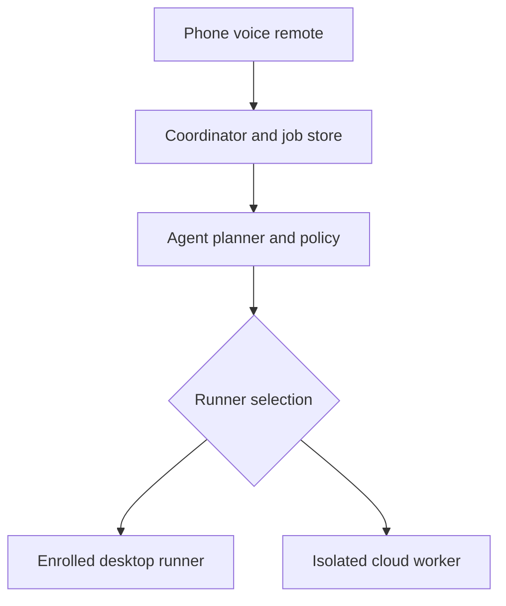

# Voice-controlled agent

> Original proposal, retained for design context. For the implemented protocol, permissions,
> and current limitations, see the [remote guide](../REMOTE.md) and [README](../../README.md).

**Engineering ideation brief · Proposed v0.1**

The phone is the remote. A user can say “Run the tests on my desktop and tell me when they’re done” or “Research this question in a cloud workspace.” The phone acknowledges once the request is recorded, then the selected runner keeps working when the app closes or the phone changes networks. The user can reopen the app to see the job, review a requested action, retrieve a result, or stop execution.

Design for one owner with a phone and one or more enrolled computers. Cover both a background job and a visible desktop action. Treat cloud execution as an account setting with explicit resource and data permissions. This brief proposes the protocol boundaries and behavior. The implementing engineer owns framework choices, platform APIs, and production sizing.

## System layout

| Component | Responsibility |
| --- | --- |
| Phone app | Capture speech, submit requests, show the selected target and status, collect approvals, request cancellation, and display or read back results. |
| Coordinator | Authenticate devices, keep durable jobs and events, evaluate routing and policy, issue short-lived execution grants, and notify the phone. One service can host these functions initially. |
| Agent planner | Turn transcribed intent into typed tool calls. Replan from results within the job's approved scope. A planner may run in the service or on a runner, depending on data settings. |
| Desktop runner | Maintain an outbound connection, report identity and current capabilities, enforce local policy, and execute in the appropriate user context. Keep background execution separate from interactive desktop control. |
| Cloud worker | Start an ephemeral workspace from an approved image, receive job-scoped inputs and credentials, return permitted artifacts, and tear down on completion or expiry. |

## 1. Voice input and feedback

- Start with push-to-talk and a text fallback. Prefer on-device transcription where it meets accuracy requirements. If cloud speech recognition is enabled, show where audio goes. Drop raw audio by default after transcription and give transcripts and results a retention policy. Device-only mode, if implemented, requires both speech recognition and agent planning to respect that boundary.
- Offer hands-free invocation through platform-supported entry points. Test a Siri/App Shortcut on iOS and an OS-supported shortcut or assistant entry point on Android. Prototype on the chosen versions and devices before promising locked-screen use. Mobile background microphone access and app execution have platform constraints. [Apple App Intents](https://developer.apple.com/documentation/appintents/getting-started-with-the-app-intents-framework) · [Apple background execution](https://developer.apple.com/documentation/uikit/about-the-background-execution-sequence) · [Android foreground service restrictions](https://developer.android.com/develop/background-work/services/fgs/restrictions-bg-start)
- Clarify only when something material is ambiguous, such as which computer or repo the user means. A voice phrase starts a request. The signed-in account, enrolled device, and approval policy supply authority. Use OS-backed user verification for sensitive confirmations.
- Return a durable job ID and a short acknowledgment such as “Queued for Windows Desktop.” Say “Running” only after the runner reports it has started. Send a generic push notification for completion, failure, or approval and fetch the full details after opening the app. The job persists independently of push delivery.

## 2. Enrollment, transport, and trust

**Enrollment.** Sign in on the phone and start pairing from the desktop companion. Show a QR code containing a short-lived, single-use enrollment challenge. Bind its redemption to the account and the desktop runner's proven public key. Confirm the named device and requested capabilities on the authenticated phone. Store private keys in OS-protected storage where available. List enrolled devices and their permissions, and allow key rotation and revocation. If OAuth is used for native sign-in, use the external browser and Authorization Code with PKCE. [OAuth for Native Apps](https://www.rfc-editor.org/rfc/rfc8252.html)

**Default network path.** Both the phone and the desktop runner make authenticated outbound TLS connections to the coordinator, so home router ports stay closed. HTTPS works for submission and control. Runners can use authenticated long polling initially, with streaming as a later optimization. Disable TLS early data for mutating requests. Retried requests use application-level idempotency. [TLS 1.3](https://www.rfc-editor.org/info/rfc9846/)

**Optional direct path.** A private mesh such as Tailscale can carry a direct phone-to-desktop session when reachable, with encrypted relay fallback depending on configuration. This is useful for larger artifacts or an explicitly enabled screen stream. Keep the coordinator as the job authority in this version. The peer still authenticates at the application layer and checks that its grant covers the job and requested operation. A LAN-only mode that works during an internet outage would need an authoritative local queue and local authorization. [Tailscale connection types](https://tailscale.com/docs/reference/connection-types)

**Data visibility.** The default coordinator can read the job fields it processes, and any hosted speech or model service can read the inputs sent to it. The mesh encrypts traffic between its peers. A broker-blind deployment would require endpoint-held encryption keys and planning at an authorized endpoint. Document what metadata the broker still sees.

## 3. Target selection and execution

| User intent or setting | Behavior |
| --- | --- |
| Names a device or needs its local files, apps, credentials, GPU, or screen | Pin the job to that enrolled device. If unavailable, show the reason and wait until a deadline or let the user cancel. Moving it to another target requires a new routing decision and any needed data approval. |
| Allows any enrolled desktop | Choose a reachable runner with the required capability and data access. Report the resolved target. Ambiguous workspace or data access goes back to the user. |
| Explicitly selects cloud or enables automatic cloud execution for this task class | Use an ephemeral worker if inputs are eligible, the tool is supported, and time and spend caps permit it. Show the resolved target and data scope. If the caps or policy block cloud, report that reason. |

Runners report last seen, OS, supported tools, and current readiness. A stale heartbeat means the device is unreachable. A healthy heartbeat still leaves GUI readiness to be checked. Desktop jobs can run headlessly if the local service, user permissions, and file access permit it. GUI jobs require a permitted interactive session and may need to wait for unlock. On Windows, use a per-user interactive process for GUI control. On macOS, obtain Accessibility permission for UI control and screen recording permission only when capture is needed. Validate Linux support against the target distro and Wayland compositor if Linux is in scope. Treat sleep recovery as a separate feature with tested platform and network prerequisites. [Windows interactive services](https://learn.microsoft.com/en-us/windows/win32/services/interactive-services) · [macOS Accessibility](https://support.apple.com/en-ie/guide/mac-help/mh43185/mac) · [macOS screen recording](https://support.apple.com/en-us/guide/mac-help/mchld6aa7d23/mac) · [XDG Remote Desktop portal](https://flatpak.github.io/xdg-desktop-portal/docs/doc-org.freedesktop.portal.RemoteDesktop.html)

Enforce cloud egress and input boundaries. Pass specific files or repo references and short-lived credentials scoped to the job. Enable no automatic mounts of personal directories or browser sessions. Capture artifacts before teardown and enforce deadlines even when the phone disconnects. Make phone-side actions a separate capability surface exposed through permitted mobile APIs and intents if needed.

## 4. Job protocol

| Operation | Proposed contract |
| --- | --- |
| `POST /v1/jobs` | Submit transcript, target preference, workspace reference if known, and client request ID. Derive account and device identity from authentication. Acknowledge only after durably recording the job. Duplicate submissions with the same authenticated device and client request ID return the original job. Reject reuse with a different payload. |
| `GET /v1/jobs/{job_id}` and event feed | Return the current state, target, and outstanding approval if present. Events carry a monotonic per-job sequence number, allowing the phone to reconnect and catch up. Notification payloads reference the job without including command output. |
| Runner claim and lease | Atomically grant a job to one eligible runner. Issue a short-lived grant scoped to runner, job, tools, workspace, and expiry. Renew while the runner is authenticated and authorized. Fence stale runners from starting new actions or committing job state after lease loss. |
| Clarify, approve, or cancel | Authenticate the caller. A clarification answer updates the pending request before target and permissions are resolved. Approvals consume a single-use challenge tied to the resolved action and its expiry. Cancel records the request durably and signals the runner. Report cancellation as complete after execution has stopped, and preserve any recorded side effects. |
| Result and artifacts | Record terminal status and measured outcomes, such as an exit code or integration response. Return artifacts through a scoped, expiring reference. Apply access checks to every fetch. |

Suggested states are `accepted`, `waiting_for_clarification`, `waiting_for_target`, `queued`, `running`, `waiting_for_approval`, `cancel_requested`, `succeeded`, `failed`, `cancelled`, `expired`, and `needs_reconciliation`. Keep the wait reason and deadline available to the phone. Pause work across an approval boundary. If an execution lease expires, stop issuing work and recover from the action journal. A producer, runner, or connection can fail after an external effect but before it was recorded. Retry read-only actions or effects protected by a stable action ID and downstream idempotency. When an effect is uncertain, use `needs_reconciliation` and verify it before offering a retry. Treat cancellation as a request to stop future work, with already completed actions recorded in the result.

**Example request.** The phone submits “Run the tests on my desktop” and gets a job ID. The planner resolves the enrolled repository and proposes `repo.run_tests`. The coordinator checks the standing grant and queues the job for Windows Desktop. When that runner claims it, the runner validates its grant, starts the test process, and reports the exit code and a log reference. The phone can reconnect later and retrieve the same result.

## 5. Tool permissions

- Start with typed tools such as `repo.run_tests`, `app.open`, and `cloud.research`. A capability declares allowed inputs, required permissions, data access, and how success is verified. The runner dispatches a validated tool call using its own enforcement layer. A test command can execute repository code, so bind it to an enrolled workspace and run it with that workspace's least-privilege environment.
- Allow routine actions under a standing grant with a defined tool, device, workspace, and expiry. Ask for a phone confirmation before sensitive actions such as sending a message, deleting files, spending money, or sharing personal data with the cloud, unless a deliberately configured policy already authorizes that exact class of action. Display the action, destination, and scope. Bind confirmation to the resolved parameters, target, and policy version. A material change requires fresh authorization.
- Treat webpages, emails, documents, and command output as untrusted data. The model can propose actions, but only the coordinator and runner can authorize and execute them. Keep admin elevation, credential export, OS security prompts, and unrestricted shell or GUI control outside the initial tool set. If broad desktop control is added, use a visible, time-limited session, an immediate local stop control, and separate rules for irreversible actions.
- Record the requesting device, selected runner, tool and scope, approval, timings, and outcome. Redact secrets and sensitive output. On revocation, invalidate future claims and renewals, and signal connected runners to stop. Keep leases short to bound disconnected operation and report any in-flight effect whose outcome is unknown.

## 6. First build and verification

Start with one phone OS and one desktop OS. A Windows desktop already reachable through Tailscale is a practical test target. Build the coordinator, push-to-talk, QR enrollment, `repo.run_tests`, and `app.open` first. Add a cloud runner using the same job and tool contracts. Then add a hands-free trigger and direct transport if warranted by the prototype. Choose the first phone OS based on the device available for end-to-end testing.

| Scenario | Acceptance criterion |
| --- | --- |
| Phone switches from Wi-Fi to cellular or the app closes | The durable job continues. Reopening the app restores current status and missed events. |
| Desktop is asleep, or its screen is locked | A device-only job preserves its target and shows why it is waiting where detectable. GUI actions wait for readiness. Eligible headless actions can continue while the screen is locked. |
| User permits cloud for a research job | An isolated worker starts within the configured limits, returns its output, and is torn down. A local-only job transfers no protected files or tool output to it. |
| Network drops during a write, or a submission is replayed | Duplicate requests map to one job. An uncertain external effect is reconciled without blindly repeating it. |
| User revokes the phone or cancels mid-job | The service rejects new submissions and approvals signed by a revoked device. Cancellation status distinguishes a stop request from observed stoppage and records any completed effects. |
| A retrieved page tells the agent to upload a file, or the action changes after review | The existing grant stays scoped to the reviewed action. The runner rejects the unauthorized call, and a materially changed action needs a fresh approval. |

The engineer should pin down the first OS pair and its locked-screen behavior, the initial desktop tool catalog and required session permissions, whether LAN-only operation is a product requirement, where planning and transcription may run by data class, and the cloud isolation, cost, and retention defaults. Prototype OS invocation and interactive-session behavior early, since those constraints determine which commands users can reliably issue hands-free.
